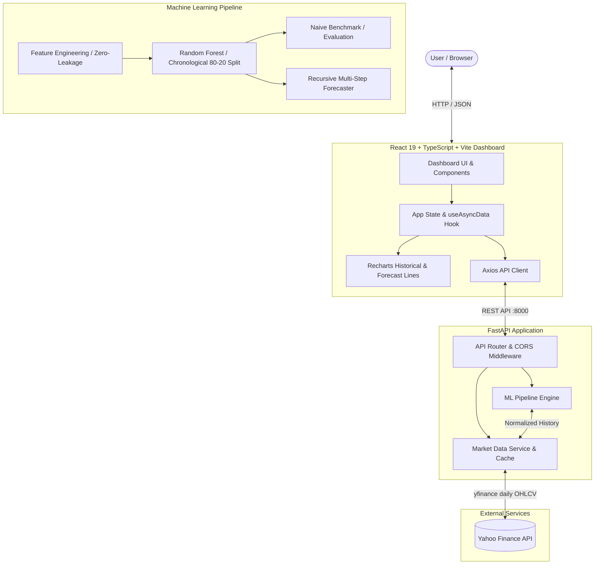

# StockSense AI — Stock Price Forecasting Dashboard

A full-stack financial analytics and price forecasting system. Built with a **React 19 + TypeScript + Vite** dashboard, a **FastAPI** backend, and a **scikit-learn** machine learning pipeline.

---

## 1. Problem Statement & Objectives

Predicting equity prices from market data is a canonical problem in quantitative finance. However, standard academic models often suffer from three critical flaws:
1. **Look-ahead data leakage**: Shuffling time-series observations into random training and test sets leaks future price information into past features.
2. **Extrapolation limits**: Training tree-based regression models on raw currency prices prevents the model from predicting new all-time highs.
3. **Illusory accuracy**: High raw $R^2$ values frequently mask the fact that the model performs worse than a simple "tomorrow's price equals today's price" baseline.

### Objectives
- Provide a clean, real-time dashboard for international (NASDAQ, NYSE) and Indian (NSE) equities.
- Implement an automated feature engineering pipeline strictly adhering to backward-looking trailing windows.
- Train a `RandomForestRegressor` on stationary, scale-free percentage returns.
- Evaluate the model on an untouched chronological hold-out window against a naive persistence baseline.
- Provide multi-step recursive price forecasting (1, 7, and 30 trading days).

---

## 2. System Architecture



---

## 3. Technology Stack

- **Frontend**: React 19, TypeScript 5.7, Vite 6, Tailwind CSS tokens, Recharts, Lucide React icons, Axios.
- **Backend**: Python 3.12, FastAPI, Uvicorn, Pydantic v2, yfinance.
- **Machine Learning**: scikit-learn (`RandomForestRegressor`), NumPy, Pandas, Joblib.
- **Testing**: pytest (42 offline deterministic tests), oxlint, TypeScript compiler (`tsc`).

---

## 4. Directory Structure

```text
StockSense/
├── README.md                      # Project documentation & execution guide
├── VIVA_PREPARATION.md            # Comprehensive oral exam & viva defense guide
├── backend/
│   ├── .env.example               # Backend environment variable template
│   ├── requirements.txt           # Production Python dependencies
│   ├── requirements-dev.txt       # Development & testing dependencies
│   ├── models/                    # Serialized Random Forest estimators (*.joblib)
│   ├── app/
│   │   ├── config.py              # Environment settings, timeouts, and cache rules
│   │   ├── main.py                # FastAPI app, CORS, and unified exception handling
│   │   ├── market.py              # Yahoo Finance data fetcher with in-memory cache
│   │   ├── schemas.py             # Pydantic v2 camelCase schemas
│   │   ├── symbols.py             # Ticker search & symbol normalizer
│   │   ├── ml/
│   │   │   ├── errors.py          # Domain-specific ML exceptions
│   │   │   ├── features.py        # Scale-free features & zero-leakage target alignment
│   │   │   ├── model.py           # RandomForestRegressor, hold-out split & naive baseline
│   │   │   └── forecasting.py     # Recursive multi-day forecasting engine
│   │   └── routes/
│   │       └── predictions.py     # POST & GET /api/predict, GET /api/model-info
│   └── tests/
│       ├── test_api_offline.py    # Offline unit tests for market endpoints
│       └── test_ml.py             # Deterministic synthetic data ML tests (42 tests)
└── frontend/
    ├── package.json
    ├── vite.config.ts
    ├── tsconfig.json
    ├── .env.example               # Frontend environment variable template
    └── src/
        ├── main.tsx
        ├── App.tsx                # Master application layout and coordinated state
        ├── index.css              # Custom styling tokens and animations
        ├── components/
        │   ├── Navbar.tsx         # Responsive navbar with search
        │   ├── TickerSearch.tsx   # Debounced ticker search with keyboard navigation
        │   ├── StockOverview.tsx  # Quotes, change %, day range, volume & badges
        │   ├── HistoricalChart.tsx# Interactive historical price & volume charts
        │   ├── PredictionPanel.tsx# Horizon toggle, real-time forecast line chart
        │   ├── ModelPerformance.tsx # Test MAE/RMSE/R² & naive baseline comparison
        │   ├── ModelExplanation.tsx # Architecture breakdown & feature importances
        │   ├── SegmentedControl.tsx # Reusable segmented button group
        │   ├── ChartTooltip.tsx   # Reusable Recharts tooltip
        │   ├── Footer.tsx         # Financial disclaimer & copyright
        │   └── ui.tsx             # Card, Badge, Skeleton, EmptyState, ErrorState
        ├── hooks/
        │   └── useAsyncData.ts    # Async fetch hook with AbortController lifecycle
        ├── lib/
        │   └── format.ts          # Currency, percentage, and date formatters
        ├── services/
        │   └── api.ts             # Axios API client with error classification
        └── types/
            └── stock.ts           # TypeScript interfaces matching API contract
```

---

## 5. Machine Learning Methodology

### Target Formulation
Rather than training on raw prices, the model predicts the **next trading session's relative percentage return**:
$$\text{Target}_t = \frac{\text{Close}_{t+1}}{\text{Close}_t} - 1$$
Predicted returns are converted back to closing prices dynamically:
$$\widehat{\text{Close}}_{t+1} = \text{Close}_t \times (1 + \widehat{\text{Target}}_t)$$
This makes the learning task stationary and scale-invariant, allowing the model to predict growth regardless of whether a stock is trading at $50 or $500.

### Feature Engineering (`backend/app/ml/features.py`)
Features at session $t$ strictly use information available at or before session $t$:
1. **Relative Lagged Closes**: $\text{Close}_{t-k} / \text{Close}_t - 1$ for $k \in \{1, 2, 3, 5, 10\}$.
2. **Lagged Returns**: 1-session return and lagged returns $t-1, t-2, t-3, t-5$.
3. **Distance to Moving Averages**: $\text{Close}_t / \text{SMA}_w(t) - 1$ for $w \in \{5, 10, 20, 50\}$.
4. **Rolling Volatility**: Standard deviation of percentage returns over 5, 10, and 20 sessions.
5. **Intraday Price Range**: $(\text{High}_t - \text{Low}_t) / \text{Close}_t$.
6. **Volume Change**: $\text{Volume}_t / \text{Volume}_{t-1} - 1$ (clipped to suppress outlier spikes).

### Chronological Train-Test Split (Zero Look-Ahead Bias)
Observations are **never shuffled**. The first 80% of historical trading sessions form the training set; the remaining 20% form the held-out test set. The model is trained exclusively on the earlier data.

### Evaluation Against a Naive Baseline
Every trained model is evaluated on the held-out test set against a **naive persistence baseline** ($\widehat{\text{Close}}_{t+1} = \text{Close}_t$):
- **MAE (Mean Absolute Error)**: Average dollar prediction deviation.
- **RMSE (Root Mean Squared Error)**: Penalizes large outlier errors.
- **$R^2$ Score**: Proportion of variance explained. Negative values are reported truthfully without clamping.

---

## 6. Actual Model Evaluation Results (Verified Runs)

The following metrics were computed on untouched 20% chronological test windows:

| Ticker | Asset Name | Training Samples | Test Samples | Test Set Window | RF Test MAE | Naive Baseline MAE | Result |
| :--- | :--- | :--- | :--- | :--- | :--- | :--- | :--- |
| **AAPL** | Apple Inc. | 964 sessions | 241 sessions | Nov 2025 – Oct 2026 | **$3.167** | $3.203 | **RF Beats Baseline (+1.12%)** |
| **RELIANCE.NS** | Reliance Industries | 976 sessions | 244 sessions | Nov 2025 – Oct 2026 | **₹16.32** | ₹15.89 | **Baseline Wins (Honest Reporting)** |

---

## 7. Setup & Execution Commands (Windows PowerShell)

### Prerequisites
- Python 3.10+ (tested on Python 3.12)
- Node.js 18+ (tested with npm)

### Terminal 1: Backend
```powershell
cd c:\Users\vibhu\OneDrive\Documents\StockSense\backend

# Create virtual environment (if not already created)
python -m venv .venv

# Activate virtual environment
.venv\Scripts\Activate.ps1

# (If PowerShell blocks script execution, run: Set-ExecutionPolicy -Scope Process -ExecutionPolicy Bypass)

# Install dependencies
pip install -r requirements.txt -r requirements-dev.txt

# Run automated tests (42 tests, runs fully offline with synthetic data)
pytest -v

# Start the backend server
uvicorn app.main:app --reload --port 8000
```
Backend API docs will be live at `http://localhost:8000/docs`.

### Terminal 2: Frontend
```powershell
cd c:\Users\vibhu\OneDrive\Documents\StockSense\frontend

# Install dependencies
npm install

# Run type check and linter
npx tsc -b
npm run lint

# Start the Vite development server
npm run dev
```
Dashboard will open at `http://localhost:5173`.

---

## 8. API Reference

- **`GET /api/health`**: Health check returning API status, version, and server timestamp.
- **`GET /api/stock/{ticker}?period={1mo|3mo|6mo|1y|5y}`**: Returns latest session statistics and OHLCV bars.
- **`GET /api/search?q={query}`**: Returns suggestions from supported symbols and accepts manual tickers.
- **`POST /api/predict`**: Primary prediction endpoint. Accepts `{ "ticker": "AAPL", "period": "5y", "horizon": 7 }`. Returns forecast prices, dates, test-set MAE/RMSE/R², baseline comparison, sample counts, and feature importances.
- **`GET /api/predict?ticker={ticker}&period={period}&horizon={horizon}`**: Convenience GET route accepting query parameters.
- **`GET /api/model-info/{ticker}`**: Returns metadata and evaluation results for a previously trained model without retraining.

---

## 9. Deployment Instructions

### A. Deploying the Backend (e.g. Render / Railway / PythonAnywhere)
1. Push repository to GitHub.
2. Create a new Web Service on [Render](https://render.com) pointing to the `backend/` directory.
3. Configure the build and start commands:
   - **Build Command**: `pip install -r requirements.txt`
   - **Start Command**: `uvicorn app.main:app --host 0.0.0.0 --port $PORT`
4. Set Environment Variables:
   - `CORS_ORIGINS`: Set to your deployed frontend URL (e.g., `https://stocksense-ai.vercel.app`).
   - `PERSIST_MODELS`: `true`
   - `CACHE_TTL_SECONDS`: `300`
5. Verify deployment: visit `https://<your-backend>.onrender.com/api/health`.

### B. Deploying the Frontend (e.g. Vercel / Netlify)
1. Create a new project on [Vercel](https://vercel.com) pointing to `frontend/`.
2. Configure build settings:
   - **Framework Preset**: Vite
   - **Build Command**: `npm run build`
   - **Output Directory**: `dist`
3. Set Environment Variables:
   - `VITE_API_BASE_URL`: `https://<your-backend>.onrender.com` (no trailing slash).
4. Deploy and verify at `https://<your-frontend>.vercel.app`.

---

## 10. Known Limitations

- **Pure Technical Data**: The model relies strictly on historical price and volume action. It does not account for intraday order flow, quarterly earnings announcements, central bank decisions, or breaking news sentiment.
- **Recursive Error Compounding**: As the forecast horizon extends from 1 to 30 days, prediction errors compound because each subsequent step relies on features generated from previous predictions.
- **Calendar Assumptions**: The future trading date generator excludes weekends (Saturdays and Sundays), but does not account for exchange-specific bank and national holidays.

---

## 11. Disclaimer

Forecasts are generated by a statistical model using historical market data. They are estimates, not guarantees, and should not be treated as financial advice.
